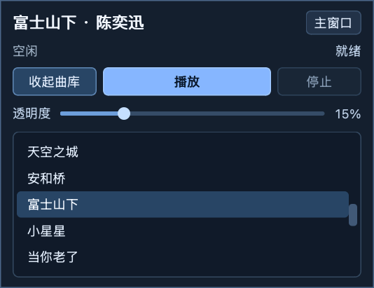

# shushu-s-harmonica

三角洲行动 PC 口琴自动演奏器 · `v1.1.0`

## 主窗口


## 置顶迷你浮窗



截图采自 macOS 的「仅测试」模式。

## 安装方法

### Windows 打包版

解压整个程序目录，使 `HarmonicaPlayer.exe` 和 `scores/` 位于同一目录。右键 EXE，选择「以管理员身份运行」。 [Windows 打包步骤](docs/DEVELOPMENT.md#打包为-exe)

### Windows 源码运行

安装 Python 3.12，在仓库页面点「Code → Download ZIP」下载并解压源码。在「开始」菜单搜索 PowerShell，选择「以管理员身份运行」。将下方第一行换成包含 `main.py` 的实际目录。 [下载 Python](https://www.python.org/downloads/windows/)

```powershell
Set-Location -LiteralPath 'C:\实际解压路径\shushu-s-harmonica-main'
py -3.12 -m venv .venv
.\.venv\Scripts\python.exe -m pip install -r .\requirements.txt
.\.venv\Scripts\python.exe .\main.py
```

以后启动时，在管理员 PowerShell 中进入项目目录并执行最后一条命令。

### macOS / Linux（仅测试）

```bash
python3 -m venv .venv
source .venv/bin/activate
python -m pip install -r requirements.txt
python main.py
```

## 更新程序

Windows 打包版点击「检查更新」时，会优先检查 GitHub Release 的完整程序包。发现新版本后，先下载并校验 SHA-256，再由 Windows 更新助手在程序退出后替换 EXE、运行依赖和内置曲谱，最后自动重启；本地曲谱与 QSettings 中的个人设置保留。

没有可用的新程序包时，按钮仍会检查并更新 Git 清单内的曲谱。旧版 v1.0 还没有完整程序更新器，需要手动安装一次 v1.1.0 或更高版本，之后即可使用应用内更新。 [曲库与更新说明](docs/LIBRARY.md#检查更新)

## 注意事项

- Windows 游戏内实奏前，确认启动日志显示「运行权限：管理员」，并验证急停热键 `Shift+F8`。
- 初次使用请先开启「仅测试」确认曲谱进度，再打开游戏里的口琴界面开始实奏。
- 游戏使用 ACE 反作弊，模拟输入可能触发账号处罚。请评估风险，本项目用于个人学习与音乐练习。

## 详细文档

- [演奏与操作](docs/PLAYBACK.md) · 播放、热键、置顶浮窗与排查。
- [曲库管理](docs/LIBRARY.md) · 导入、在线更新、备份和曲谱版本。
- [曲谱与演奏规则](docs/SCORE_FORMAT.md) · TXT、MIDI、键位、移调和时序。
- [开发与打包](docs/DEVELOPMENT.md) · 项目结构、Windows 打包和测试。
- [设计文档](docs/DESIGN.md) · 程序架构、输入保护和调度实现。
- [修订日志](docs/CHANGELOG.md) · 历次更新。
