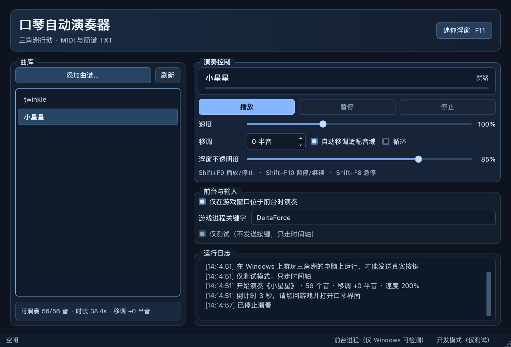

# shushu-s-harmonica

> 鼠鼠猛攻5枪撤离，给大哥表演即兴节目专用。

三角洲行动（Delta Force）PC 端**口琴自动演奏器**：把 MIDI 或简谱 TXT 转换成游戏内的键盘 + 鼠标输入，自动完成整首曲子。

本工具在桌面层通过 Windows `SendInput` 模拟前台键鼠操作，**不注入游戏进程、不读写游戏内存、不修改网络封包**，也不依赖任何第三方输入驱动。



> **风险提示**：游戏使用 ACE 反作弊，任何形式的模拟输入都可能被判定为违规，存在封号风险。请自行评估并承担使用后果，建议仅在单人/自定义房间或非重要账号上尝试。本项目仅供个人学习与音乐练习交流。

---

## 目录

- [功能特性](#功能特性)
- [快速开始](#快速开始)
- [使用流程](#使用流程)
- [键位与音域映射](#键位与音域映射)
- [节奏与时序模型](#节奏与时序模型)
- [安全机制](#安全机制)
- [全局热键](#全局热键)
- [简谱 TXT 格式](#简谱-txt-格式)
- [MIDI 处理规则](#midi-处理规则)
- [移调与音域适配](#移调与音域适配)
- [界面说明](#界面说明)
  - [迷你浮窗](#迷你浮窗)
- [项目结构](#项目结构)
- [设计与架构](#设计与架构)
- [打包为 exe](#打包为-exe)
- [已验证与待验证](#已验证与待验证)
- [常见问题](#常见问题)
- [已知限制](#已知限制)
- [修订日志](#修订日志)

---

## 功能特性

- **双曲谱来源**：标准 MIDI（`.mid` / `.midi`，type 0/1）与简谱 TXT。
- **完整音域映射**：覆盖游戏口琴 MIDI 48–85（C3–C#6），包含最高音区 `逗号` 键的特殊规则。
- **自动单音化**：多轨/和弦 MIDI 优先选同一簇中能在当前速度下演奏的最高音，适配游戏单音口琴。
- **移调**：手动 ±12 半音；支持自动移调，最大化落进游戏音域的 note 数；超界音高自动八度折返。
- **真实节奏**：按 MIDI/谱面时值演奏，12ms 预备、40ms 最短保持、20ms 尾隙，过短音符自动跳过。
- **安全演奏**：3 秒倒计时、仅前台检测、失焦自动暂停、停止/暂停/退出时释放全部按键。
- **全局热键**：`Shift+F9` 播放/停止、`Shift+F10` 暂停/继续、`Shift+F8` 急停。Windows 上可用 `F11` 切换悬浮窗。
- **仅测试模式**：默认开启，只走时间轴，不发送按键。macOS/Linux 上固定使用此模式。
- **主窗口**：导入和管理曲库、设置演奏参数、查看实时音符进度与输入状态。
- **悬浮窗**：置顶显示曲名、状态和进度，可直接选曲、控制播放、拖动和调透明度。

## 快速开始

### Windows（可发送真实按键）

使用 Windows 10/11 和 Python 3.12。首次安装可在官网下载 Python install manager，安装后重新打开 PowerShell，运行 `py install 3.12`。 [Python Windows 下载页](https://www.python.org/downloads/windows/)

在仓库页面点「Code → Download ZIP」并解压。打开包含 `main.py` 和 `requirements.txt` 的文件夹，在文件资源管理器地址栏输入 `powershell` 并按回车，然后逐行执行下面的命令。

```powershell
py -3.12 --version
py -3.12 -m venv .venv
.\.venv\Scripts\python.exe -m pip install -r .\requirements.txt
.\.venv\Scripts\python.exe .\main.py
```

第一条命令用来确认 Python 3.12 可用。以后从同一目录启动时，只需运行最后一条命令。需要生成可分发的程序时，可以双击 `build_exe.bat`。 [打包为 exe](#打包为-exe)

首次使用建议：

1. 默认勾选「仅测试」。选一首曲谱点播放，确认时间轴和进度正常。
2. 在游戏中解锁并装备口琴，再确认日志中的急停热键注册结果和游戏进程关键字。状态栏显示当前前台进程名。
3. 取消「仅测试」并点播放，利用 3 秒倒计时切回游戏，打开口琴界面。

### macOS / Linux（仅测试）

```bash
python3 -m venv .venv
source .venv/bin/activate
pip install -r requirements.txt
python main.py
```

非 Windows 平台会自动锁定「仅测试」模式，只验证曲谱解析、映射和演奏时序，不会发送任何按键。

## 使用流程

曲库内置两首示例、37 份图片转录谱和 10 份单音谱，共 49 首。其中 34 份键位图片转录谱的长短音和停顿按乐句估算。

1. **准备曲谱**：把 `.mid` / `.midi` / `.txt` 放进 `scores/`，或通过「添加曲谱…」多选、拖入窗口导入。导入会把文件复制到曲库，保留已有同名文件。
2. **更新曲库**：点击「检查更新」，从 GitHub `main` 分支的 `scores/` 获取新增或变更文件。只有 `scores/.git-scores.json` 清单中的 Git 内置曲目允许被覆盖更新；未列入清单的文件视为本地曲目，即使与远端同名也不覆盖。远端新增曲目安装后会自动加入清单，原文件备份在 `scores/.update-backups/`。所有文件下载并通过 Git blob 校验值核对、试解析后才安装，不会自动下载或执行 EXE 或脚本。若要修改内置曲目并保留自己的版本，请另存为不同文件名。
3. **选择曲谱**：解析完成后，列表下方显示当前速度下可演奏的音符数、预计时长和实际移调量。
4. **调整参数**：
   - 速度：50%–200%。
   - 移调：−12 ~ +12 半音。
   - 自动移调适配音域：默认开启，对整首曲子统一移调，尽量全部落进 48–85。
   - 循环：播放结束后间隔 0.8 秒重新开始。
5. **前台与输入**：
   - 仅前台演奏：倒计时后等待匹配的前台窗口，并绑定该窗口。失焦时暂停，回到同一窗口后继续。
   - 游戏进程关键字：默认 `DeltaForce`，按实际进程名做不区分大小写的子串匹配。启用前台保护时必须填写。
6. **开始演奏**：点「播放」或按 `Shift+F9`，等待 3 秒倒计时。`Shift+F10` 暂停/继续，`Shift+F8` 或「停止」请求结束并释放本次演奏按下的键。倒计时、等待游戏、演奏和暂停期间，曲库与播放设置暂时锁定。

## 键位与音域映射

游戏口琴的基础按键为 `Z X C V B N M ,`，配合鼠标修饰键：

| 修饰 | 作用 | SendInput 标记 |
|---|---|---|
| 按住鼠标左键 | 降八度 | LEFTDOWN / LEFTUP |
| 按住鼠标右键 | 升八度 | RIGHTDOWN / RIGHTUP |
| 按住鼠标中键 | 升半音（#） | MIDDLEDOWN / MIDDLEUP |

自然音级与按键：

| 音级 | 1 (do) | 2 (re) | 3 (mi) | 4 (fa) | 5 (sol) | 6 (la) | 7 (si) | 高音 1 (do') |
|---|---|---|---|---|---|---|---|---|
| 按键 | `Z` | `X` | `C` | `V` | `B` | `N` | `M` | `,` |
| 扫描码 | 0x2C | 0x2D | 0x2E | 0x2F | 0x30 | 0x31 | 0x32 | 0x33 |

音区与修饰组合（MIDI 48–85）：

| MIDI 范围 | 音区 | 组合方式 |
|---|---|---|
| 48–59 | C3–B3 | `Z`–`M` + **左键（降八度）** |
| 60–71 | C4–B4 | `Z`–`M`，无修饰 |
| 72 | C5 | `,`，无修饰 |
| 73 | C#5 | `,` + **中键（升半音）** |
| 74–83 | D5–B5 | `X`–`M` + **右键（升八度）** |
| 84 | C6 | `,` + **右键（升八度）** |
| 85 | C#6 | `,` + **右键 + 中键** |

升半音规则：除最高音的 C#5 / C#6 外，所有 `#` 音都使用「下方自然音键 + 中键」，并叠加对应的八度修饰。例如：

- `C#3` = `Z` + 左键 + 中键
- `F#4` = `V` + 中键
- `A#4` = `N` + 中键
- `A#5` = `N` + 右键 + 中键

最高音区只支持 `do / #do`（C6/C#6），更高的 D6–B6 在游戏中不可用；本工具会通过移调和八度折返把音高拉回 48–85。

> 映射与修改时间等细节的推导过程见 [docs/DESIGN.md](docs/DESIGN.md)。

## 节奏与时序模型

起点与时值按播放速度换算为实际时间，再按下述规则调度：

```text
keydown 目标时刻 = 实际起点 + 12ms
keyup   目标时刻 = 实际终点 − 20ms
```

| 常量 | 值 | 说明 |
|---|---|---|
| `PREP_MS` | 12ms | 音键按下前的修饰键准备时间，确保游戏识别到升降状态 |
| `MIN_HOLD_MS` | 40ms | 最短按住时长，避免游戏忽略极短输入 |
| `DEFAULT_GAP_MS` | 20ms | 尾隙，提前松开音键，避免相邻音粘连 |
| 最短可演奏时长 | 72ms | `12 + 40 + 20`，按当前速度换算后短于此值的音符会跳过并计数 |

其他时序行为：

- 鼠标修饰键在音键按下前按下，在音键松开后按相反顺序释放。
- 每个音符都会完整「按下→松开」修饰键和音键，**不会在按住音键时切换修饰键**，避免游戏把修饰键变化识别为新音符重新触发。
- 调度迟到时会使用尾隙吸收延迟。预备或最短保持时间放不下时跳过该音，后续音符仍按原时间轴调度。
- 暂停（手动或失焦）时会释放本次演奏按下的键。继续时从被打断的音符起点重播该音。两音之间暂停时，继续等待原有的剩余间隔。
- 曲谱尾部休止保留。循环在整首时间轴结束后另等 0.8 秒。
- Windows 后端在播放会话请求 `timeBeginPeriod(1)`，成功后在会话结束时调用 `timeEndPeriod(1)`。

## 安全机制

| 机制 | 行为 |
|---|---|
| 3 秒倒计时 | 点播放后留出切回游戏的时间 |
| 仅前台演奏（默认开） | 首次匹配后绑定窗口句柄及进程 ID，切回同一窗口才继续 |
| 暂停/停止即释放 | 演奏线程释放本次记录为按下的键和鼠标键，释放失败时记录错误 |
| 急停热键强制校验 | 确认 `Shift+F8` 注册成功后才允许真实演奏。演奏中注册失效会请求停止 |
| 仅测试模式 | 默认开启，只走时间轴，不发送任何输入。非 Windows 固定开启 |
| 权限提示 | 启动时显示普通用户/管理员；工具与游戏权限不一致时 `SendInput` 可能失败并给出提示 |
| 退出清理 | 关闭窗口时先请求停止，待演奏线程完成清理后关闭 |

使用建议：

- 游戏使用**无边框窗口**，避免焦点切换导致输入丢失。
- 切换到**英文输入法**，某些输入法会拦截按键。
- 工具和游戏使用**相同权限**（游戏以管理员运行时，工具也需管理员运行）。
- 演奏期间不要手动按 `Z`–`M`，避免与自动输入叠加。

## 全局热键

| 热键 | 功能 | 实现 |
|---|---|---|
| `Shift+F9` | 播放 / 停止 | `RegisterHotKey` + 独立消息循环线程 |
| `Shift+F10` | 暂停 / 继续 | 同上 |
| `Shift+F8` | 急停 | 热键线程直接请求停止，演奏线程负责清理 |
| `F11` | 切换主窗口和悬浮窗 | Windows 优先注册全局热键。全局热键不可用时，可在主窗口内按 `F11` 打开悬浮窗 |

播放、暂停和急停热键带 `Shift` 前缀，以避开游戏常用的单键。全局热键使用 `MOD_NOREPEAT` 避免长按连续触发。播放、暂停和界面通知通过 Qt 信号处理，急停请求无需等待 Qt 主线程处理。

## 简谱 TXT 格式

简谱 TXT 使用 UTF-8 编码。

```text
TITLE=小星星
BPM=100

1 1 5 5 6 6 5 - 4 4 3 3 2 2 1 -
1 1 5 5 6 6 5 - 4 4 3 3 2 2 1 -
```

规则：

- `TITLE=...`：曲名，可省略，默认使用文件名。
- `BPM=...` 表示速度，省略时为 100。填写时须为有限数字，自动限制在 20–300 并取整。
- `GRID=...` 指定一拍分为几个时值单位，默认 1，整数会限制在 1–16。使用 `GRID=4` 时，一个单位是四分之一拍。
- `//`：行内注释；`|` 视为分隔符（可当小节线使用）。
- 音符：`1`–`7` 为自然音级，`0` 为休止。
- `8` 或 `i`：高音 `do`（即 `1` 升一个八度，对应游戏 `,` 键）。
- 前缀 `b`：降一个八度（可叠加，如 `bb1`）；前缀 `^`：升一个八度（可叠加）；`#`：升半音。例如 `b1`、`#1`、`^#1`、`bb3`。
- 后缀 `-` 每出现一次，音符或休止多持续一个时值单位。默认一单位一拍，`GRID=4` 时 `5---` 持续一拍。低音 5 写 `b5`，`5-` 表示中音 5 持续两格。
- 单独的 `-` 延长前一个音符或休止一个时值单位。
- 以中央 C（C4，MIDI 60）为基准，`1` = C4。
- 无法识别的记号会报出行号和原记号。带 `@format` 的文本谱和键位文本谱需要先转换成标准 MIDI 或本节所述的简谱 TXT。

### 曲库版本与节拍检查

- 《送别》和《爱尔兰画眉》收录单音旋律版，《大鱼》收录 C 调主歌选段。「试奏」表示旋律与原曲的对应关系仍需核对，「曲名待确认」表示该文件为原曲身份待核的练习片段。
- `GRID=4` 时，4/4 的完整小节占 16 格，3/4 占 12 格。音符和休止都计入拍数。弱起或结尾不足整小节时，应按实际时值并注释说明。`|` 用于标记位置，播放器不会在此处自动增加休止。
- 在 100% 速度下检查可演奏音符数和跳过数量，再对照同一版本的旋律、起拍、延音和休止试听。音符通过播放检查只说明时值与音域符合播放器的要求。

## MIDI 处理规则

- 支持使用 PPQ 计时的 type 0 / type 1。type 2 与 SMPTE 计时会报错。
- 忽略打击乐通道（channel 10，0-based index 9）。
- `note_on` 且 velocity > 0 视为按下；`note_off` 或 velocity = 0 的 `note_on` 视为松开。
- 各轨共用速度变化。按轨道、通道和音高匹配按下与松开。重复按下时先结算上一个音，文件结束仍按住的音按 0.5 秒收尾。曲谱长度保留轨道末尾的休止。
- **单音化**：从每簇第一个起点起，把相差小于 30ms 的音归为一簇。每簇从高到低挑选一个能在当前速度下演奏的音，时值最晚截到下一簇起点。全簇都过短时跳过该簇。

## 移调与音域适配

- 自动移调在应用手动偏移后，再在 ±30 半音内选取「落进 48–85 的可演奏音符数最多」的方案。数量相同时取绝对值较小的自动偏移。
- 手动移调与自动移调会叠加，最终结果会显示在曲谱信息与演奏日志中。
- 移调后仍在音域外的音会按 ±12 半音折返到 48–85；折返不改变音级，但会改变实际音区，听感可能与原曲有八度差异。

## 界面说明

| 模块 | 位置与操作 |
|---|---|
| 曲库 | 左侧选曲，可添加、刷新或拖入多个 MIDI、TXT 文件。解析完成后可双击播放，列表下方显示可演奏音符数、预计时长和实际移调。 |
| 演奏控制 | 右侧提供播放、暂停、停止、速度、移调、自动适配和循环。播放时显示当前音符进度和对应按键，也可在这里调整浮窗不透明度。 |
| 前台与输入 | 在右侧设置仅前台演奏、游戏进程关键字和仅测试模式。 |
| 运行日志 | 在右下查看热键注册、曲谱导入、过短音符跳过、失焦和停止等记录。 |
| 状态栏 | 在窗口底部查看播放状态、前台进程匹配结果和运行权限。 |

### 迷你浮窗


点击主窗口右上角的「迷你浮窗」，或按 `F11` 打开。浮窗置顶显示曲名、状态与进度，可播放、暂停、继续和停止。点击「主窗口」可以展开完整界面。

点击「选曲」，在展开的列表中滚动并点选曲谱。播放中选另一首会先停止当前播放，再切换到选中的曲目。点击「播放」开始新曲。点选当前曲目会保留原来的播放状态。

浮窗的「透明度」范围为 0%–65%，默认 15%，向右拖动更透明。主窗口显示对应的「浮窗不透明度」，范围为 35%–100%，默认 85%。两处设置同步，浮窗位置和透明度会在下次打开时恢复。拖动浮窗空白处可以调整位置。

## 项目结构

```text
.
├── main.py                  # 程序入口
├── core/
│   ├── score.py             # MIDI / TXT 解析与单音化
│   ├── mapping.py           # 音高→按键映射、移调、音域折叠
│   ├── engine.py            # 演奏线程、时序、暂停/循环/状态机
│   ├── input_backend.py     # Win32 SendInput、前台进程检测、DryRun
│   └── hotkeys.py           # 全局热键消息循环
├── ui/
│   ├── main_window.py       # PySide6 主界面与信号桥
│   └── mini_window.py       # 迷你浮窗
├── scores/
│   ├── twinkle.mid          # 示例 MIDI（42 音）
│   ├── 小星星.txt            # 示例简谱（56 音）
│   └── 其他 TXT              # 图片转录谱和单音谱
├── docs/
│   ├── DESIGN.md            # 详细设计文档
│   ├── screenshot.png       # 主窗口截图
│   └── mini-window.png      # 迷你浮窗截图
├── tests/                   # 曲谱、播放调度、热键与悬浮窗测试
├── requirements.txt
├── build_exe.bat            # Windows 打包脚本
└── .gitignore
```

## 设计与架构

```text
MIDI / TXT ──> score.py ──> ScoreEvent[] ──> mapping.py ──> PlayNote[]
                                                            │
                                                    engine.Player（演奏线程）
                                                            │
                              ┌─────────────────────────────┼─────────────────────────┐
                              ▼                             ▼                         ▼
                      input_backend.Win32Backend    hotkeys（全局热键）        ui.MainWindow（Qt 信号桥）
                      SendInput / DryRun            独立消息循环线程           状态、进度、日志
```

核心原则：

1. **曲谱解析与输入执行解耦**：解析层保留带绝对时间的音符和备选音，映射层生成与设备无关的单音按键计划，便于离线测试。
2. **时序以音乐时钟为准**：每轮按绝对时间调度音符，暂停时平移时间轴，打断演奏中的音符时从该音重播。
3. **输入层只做前台模拟**：使用扫描码 `KEYEVENTF_SCANCODE` 和鼠标事件，不注入、不挂钩、不读内存；只释放自己按下的键。
4. **输入默认关闭**：Windows 上可关闭「仅测试」，确认急停热键可用后才允许真实输入。
5. **UI 与工作线程通过 Qt 信号通信**：工作线程发出解析、状态和日志信号。急停请求直接发给演奏线程。
6. **曲库更新只替换数据文件**：更新器通过 HTTPS 读取 GitHub 清单，先在临时目录下载、校验并解析，再原子替换内置同名谱；不下载或执行程序代码。

完整设计推导、状态机、时序公式、测试记录与取舍见 **[docs/DESIGN.md](docs/DESIGN.md)**。

## 打包为 exe

在 Windows 上双击 `build_exe.bat`，脚本会：

1. 安装 `requirements.txt` 和 PyInstaller。
2. 以窗口模式打包为 `HarmonicaPlayer`。
3. 把 `scores/` 复制到 exe 同级目录。

输出：`dist\HarmonicaPlayer\HarmonicaPlayer.exe`。

打包后 `scores/` 位于 exe 旁边的 `scores/` 目录，新增曲谱和 `.git-scores.json` 归属清单都会保存在那里，不会写进临时解包目录。点击「检查更新」即可联网更新清单内的 Git 曲目，无需重新打包；程序功能更新仍需重新打包 EXE。

## 已验证与待验证

安装依赖后，可以用标准库 `unittest` 运行离线回归测试：

```bash
python -m unittest discover -s tests -v
```

测试覆盖曲谱解析、倍速可演奏性、失焦暂停与急停、曲末休止、循环间隔、热键注册、浮窗选曲和透明度同步。

**待 Windows + 游戏实机验证：**

- `SendInput` 扫描码在游戏内是否被正确识别（取决于权限、输入法、窗口模式）。
- 全局热键在实际游戏环境中的注册与响应。
- 悬浮窗在 Windows 游戏窗口化或无边框模式下的置顶和焦点行为。
- 不同进程名/反作弊版本下的前台检测匹配。

## 常见问题

**Q：游戏里没有反应？**
先确认游戏已打开口琴界面且处于可输入状态；其次检查工具与游戏权限是否一致、是否切换到英文输入法、是否使用无边框窗口；最后查看日志中有无 `SendInput` 错误。可以先用「仅测试」确认时间轴正常。

**Q：热键没反应？**
热键可能被其他程序占用，日志会显示注册结果。真实演奏要求 `Shift+F8` 注册成功。游戏内按 `F11` 无效时，可在主窗口点击悬浮窗按钮。关闭占用程序后重启本工具，可重新尝试注册。

**Q：状态栏显示的前台进程不匹配？**
把「游戏进程关键字」改成实际进程名片段，例如 `DeltaForceClient`。启用前台保护时，空关键字会阻止开始演奏。

**Q：为什么有的音符没弹？**
用于准备、按住和留白的实际时长至少需要 72ms。提高速度会缩短可用时长，密集音符可能被跳过。可以降低速度并查看曲谱信息中的跳过数量。

**Q：移调量和我设置的不一样？**
「自动移调适配音域」会根据手动偏移后的谱面补充自动移调，日志中的「移调 ±N 半音」是实际应用值。关闭自动适配即可只用手动值。

**Q：macOS 上为什么不能发按键？**
本工具的真实输入后端基于 Windows `SendInput`；其他系统只能使用「仅测试」模式验证曲谱和时序。

## 已知限制

- 仅演奏**单音**旋律。导入和弦或多轨 MIDI 时，每个近似同时起音的音组只取一个能演奏的音。
- 暂不支持选择 MIDI 轨道、试听、播放列表、节拍器。
- 最高音区只支持 C6/C#6（`do / #do`），更高音通过移调/八度折返处理。
- 自动音域适配可能改变原曲的八度听感。
- 三组 Shift 播放热键与 `F11` 悬浮窗热键采用固定绑定。
- 游戏进程名关键字默认 `DeltaForce`，不同客户端可能需要手动调整。

## 修订日志

每次更新在表格顶部新增一条记录。

| 日期 | 修订内容 |
|---|---|
| 2026-11-26 | 曲库更新增加 Git 归属清单：只覆盖清单内内置曲目，本地同名曲目保留不覆盖，新增 Git 曲目自动登记。 |
| 2026-11-26 | 新增联网曲库更新：检查 GitHub 变更、校验下载文件、备份并替换内置同名谱，保留用户新增曲谱。 |
| 2026-11-26 | 新增孙燕姿《我不难过》端游键位谱转录版，C 调键位、节奏按歌词断句估算，曲库增至 49 首。 |
| 2026-11-26 | 新增陈奕迅《富士山下》图谱转录版，保留 F 调和前奏，并展开反复与两个结尾，曲库增至 48 首。 |
| 2026-11-26 | 新增《Lemon》端游键位谱转录版，音高按键位图，节奏按乐句估算，曲库增至 47 首。 |
| 2026-11-26 | 新增苏打绿《我好想你》图谱转录版，保留 A 调与两遍反复，曲库增至 46 首。 |
| 2026-11-26 | 更新 10 首内置曲谱：按谱重写《送别》《爱尔兰画眉》，替换《大鱼》主歌选段，校正试奏谱的小节时值并标注曲谱版本。 |
| 2026-11-26 | 新增《大鱼》《送别》《天空之城》等 10 首单音试奏谱，曲库增至 45 首。 |
| 2026-11-26 | 新增《心做し》的图片简谱转录版。 |
| 2026-11-26 | 内置 32 首图片转录试奏谱，支持通过 `GRID` 设置更细的简谱时值。 |
| 2026-11-26 | 迷你浮窗支持从曲库直接选曲，透明度滑块改为向右更透明。 |
| 2026-11-26 | 更新主窗口和迷你浮窗的配色与控件，替换两张界面截图，补齐 Windows 启动步骤。 |
| 2026-11-26 | 加入迷你浮窗、`F11` 切换、透明度调整和本机位置保存。 |
| 2026-11-26 | 整理使用说明，统一不受支持的曲谱格式提示。 |
| 2026-11-26 | 改进前台保护、急停、暂停恢复和倍速调度，修正多轨 MIDI 与简谱 TXT 解析。 |
| 2026-11-26 | 提供首版口琴自动演奏功能，支持 MIDI、简谱 TXT 和仅测试模式。 |
